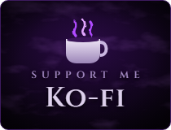
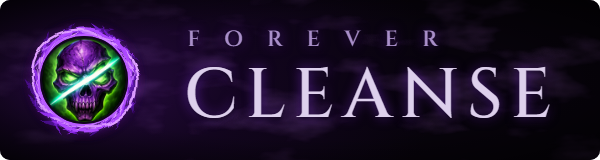
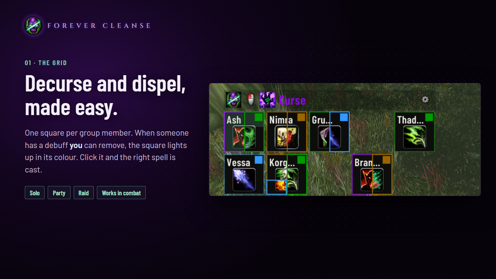
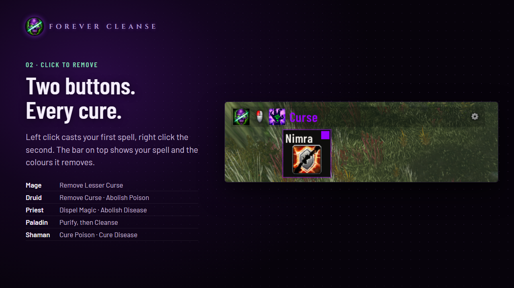
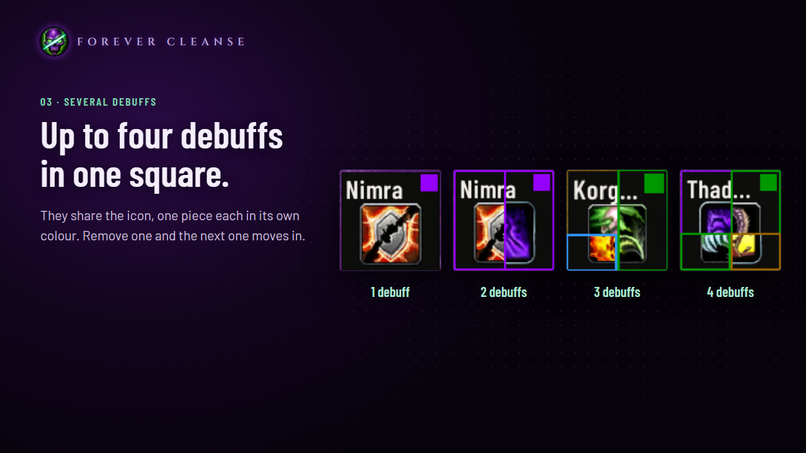
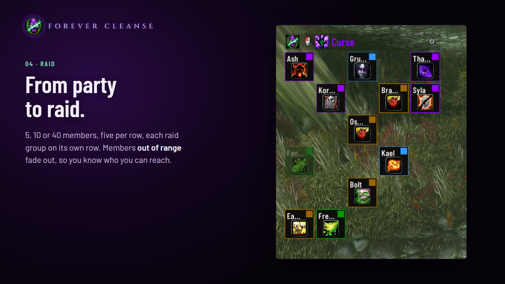
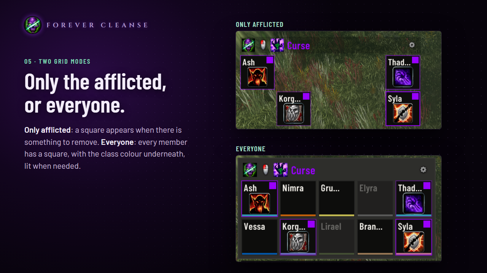
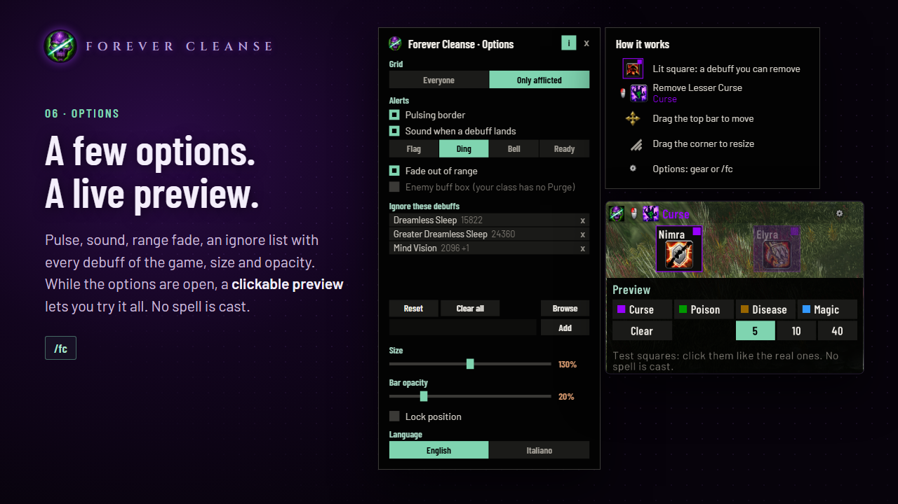

  
  
  
  
  
  

Decurse and dispel made easy for **WoW: Forever**.

A small grid with one square per group member. When someone has a debuff that **you** can remove, their square lights up with the colour of the debuff type, the debuff icon and its duration. Click the square and the right spell is cast. Works solo, in party and in raid, also in combat.

## How it works

- **One square per member**, 5 per row in group order. In a raid each group starts a new row.
- **Lit squares**: a border in the type colour (Curse purple, Poison green, Disease brown, Magic blue), the type symbol in the corner, the debuff icon and its duration. Only the debuffs your class can remove are shown.
- **Several debuffs on one member**: up to four share the icon, one piece each in its own colour (half and half, then quarters). When one is removed the next one moves in.
- **Click to remove**: left button = your first spell, right button = your second one. The bar at the top shows which button removes which colours. Classes with a single spell use the left button.

| Class | Left button | Right button |
|---|---|---|
| Mage | Remove Lesser Curse | — |
| Druid | Remove Curse | Abolish Poison / Cure Poison |
| Priest | Dispel Magic | Abolish Disease / Cure Disease |
| Paladin | Purify, then Cleanse | — |
| Shaman | Cure Poison | Cure Disease |

- **In combat**: squares and clicks keep working. The game does not let addons move secure buttons in combat, so players who join mid-fight and option changes appear when the fight ends.

## Options

Open them with the gear at the top right of the bar, a right-click on the bar, or `/fc`. The **i** button explains everything in game. While the options are open, a clickable **preview** sits over the grid: add test debuffs, click the squares, try 5 / 10 / 40 members. No spell is cast.

- **Grid**: *Everyone* (all squares, lit when needed) or *Only afflicted* (a square appears only when there is something to remove).
- **Alerts**: pulsing border when a debuff lands, a **sound** played by the game itself (also in combat, pick one of four), fade out of range.
- **Enemy buff box** (Priest, Shaman): the buffs of your enemy target you can remove; click to cast Dispel Magic or Purge.
- **Ignore list**: debuffs you never want to see. Type a name or spell ID, or press **Browse** to pick one from every Curse, Poison, Disease and Magic debuff of the game (all its ranks are added). Dreamless Sleep and Mind Vision are there from the start.
- **Size** (60–200%, also with the corner grip), **bar opacity**, **lock**, **language** (English, Italiano).

Commands: `/fc` options · `/fc lock` · `/fc reset` · `/fc help`.

## Italiano

Una griglia con una casella per ogni compagno: si accende quando qualcuno ha un debuff che **tu** puoi togliere, e un click lancia la spell giusta (sinistro = prima spell, destro = seconda). Funziona da solo, in party e in raid, anche in combattimento. Opzioni con l'ingranaggio in alto a destra o `/fc`; il pulsante **i** spiega tutto in gioco, e l'anteprima cliccabile permette di provarlo senza lanciare spell. Testi in inglese e italiano.

## Support

If Forever Cleanse saves your raid, you can buy me a coffee:

## Install

Download it from CurseForge, or copy the `addon/ForeverCleanse` folder into `World of Warcraft/_forever_/Interface/AddOns/`.

## Development

`node tools/debuffs.js <csv folder>` rebuilds `Debuffs.lua` from the game's spell tables (SpellCategories, SpellName, SpellEffect of build 1.60.1.70959, from wago.tools).

`node tools/test.js` runs `Core.lua` on a small fake WoW (needs [fengari](https://github.com/fengari-lua/fengari) installed in `%LOCALAPPDATA%/fp-lua`).

Fonts: Barlow by Jeremy Tribby, SIL Open Font License (`addon/ForeverCleanse/Fonts/OFL-Barlow.txt`). No Blizzard files are included: game icons are used by name. The logo is original art made for this project (`media/logo-sheet.png`); `node tools/logo.js` crops it into `media/logo-400.png` and the in-game texture, and renders the banner.

License: MIT.
